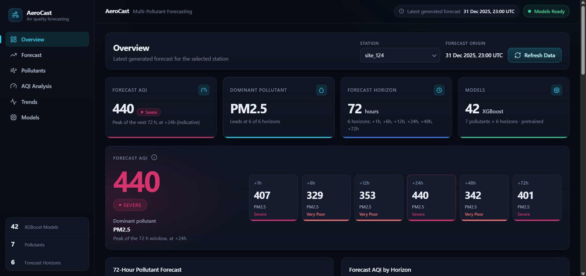
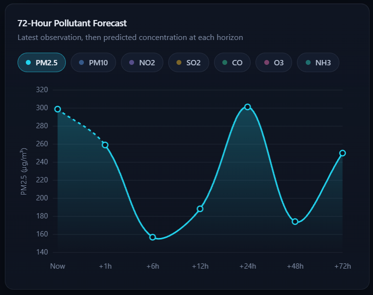
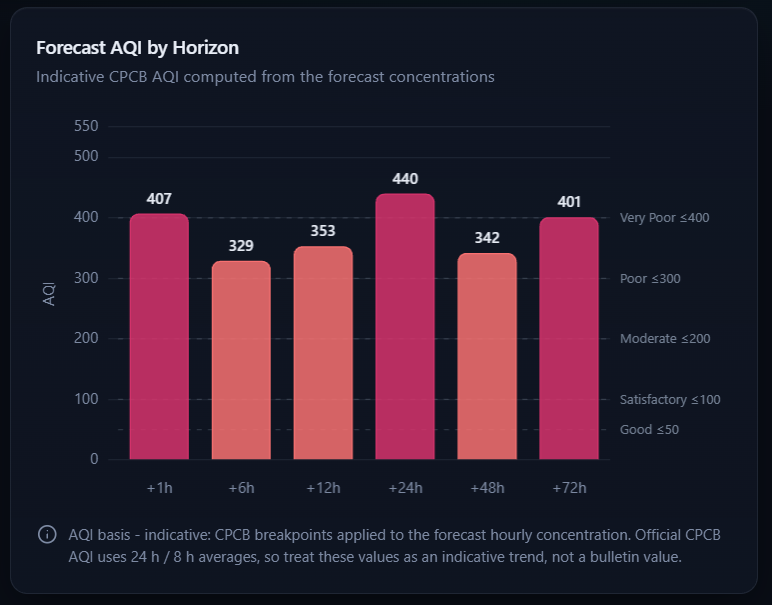
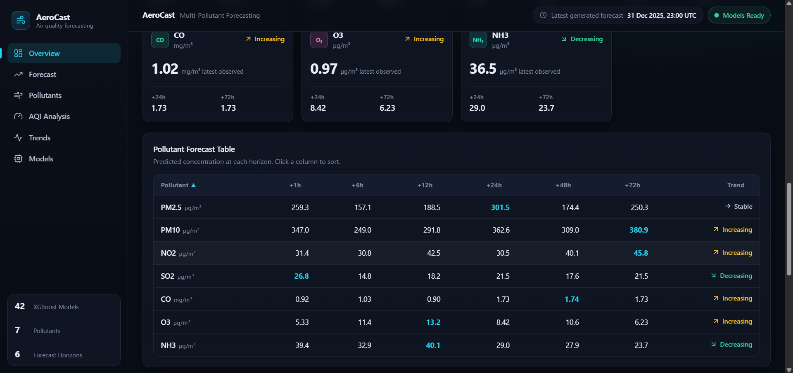
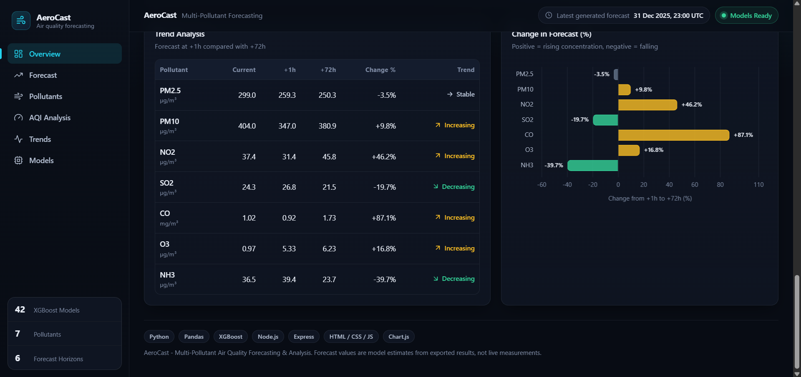
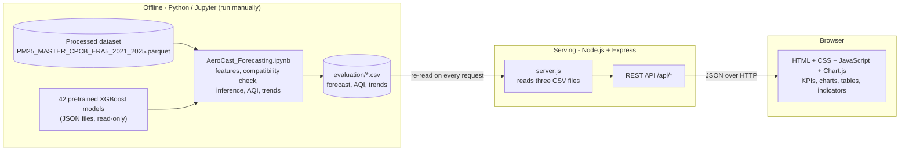

# AeroCast — Multi-Pollutant Air Quality Forecasting & Analysis

AeroCast is an applied machine-learning project that forecasts **seven air pollutants at six horizons (+1 h to +72 h)** for a monitoring station in Delhi, using historical CPCB (Central Pollution Control Board) observations combined with ERA5 reanalysis weather features. A Jupyter notebook runs **42 pretrained XGBoost regression models** and exports forecast, AQI and trend tables as CSV files; a small Node.js/Express API serves those files to a responsive HTML/CSS/JavaScript dashboard.

> **Read this first.** AeroCast produces *model-based estimates* derived from a historical dataset ending on 31 December 2025. They are not measurements, not guaranteed future values, and not a substitute for official air-quality bulletins. The dashboard displays **previously exported** results; it does not run the Python pipeline or retrain anything. The 42 models were **pretrained by another contributor**; this repository's own work is the inference/integration notebook, the AQI and trend analysis, the API and the dashboard (see [Section 16](#16-skills-demonstrated)).

---

## Table of Contents

1. [Overview](#1-overview)
2. [Key Features](#2-key-features)
3. [Dashboard Preview](#3-dashboard-preview)
4. [System Architecture](#4-system-architecture)
5. [Technology Stack](#5-technology-stack)
6. [Dataset and Features](#6-dataset-and-features)
7. [Machine Learning Methodology](#7-machine-learning-methodology)
8. [Evaluation and Performance](#8-evaluation-and-performance)
9. [Forecast Output Files](#9-forecast-output-files)
10. [Indicative AQI Calculation and Limitations](#10-indicative-aqi-calculation-and-limitations)
11. [Local Installation and Setup (Windows)](#11-local-installation-and-setup-windows)
12. [API Documentation](#12-api-documentation)
13. [Project Limitations](#13-project-limitations)
14. [Future Improvements](#14-future-improvements)
15. [Project Structure](#15-project-structure)
16. [Skills Demonstrated](#16-skills-demonstrated)
17. [Author, Credits and License](#17-author-credits-and-license)
18. [Open Items to Verify](#18-open-items-to-verify)

---

## 1. Overview

**The problem.** Air quality changes with emissions, weather and time of day. Knowing only the current concentration of one pollutant is rarely enough to anticipate how a day or a weekend will unfold. Different pollutants also behave differently: particulate matter (PM2.5, PM10) is strongly shaped by atmospheric mixing and wind, while ozone (O3) is formed photochemically and follows a very different daily cycle. Forecasting several pollutants at several lead times therefore gives a fuller picture than a single number.

**What AeroCast does.**

- Loads a processed Parquet dataset of hourly CPCB observations and ERA5-derived features.
- Loads **42 pretrained XGBoost models** — one per pollutant × horizon (7 × 6) — and checks that the dataset can supply exactly the features each model expects.
- Generates 42 concentration forecasts from a chosen station and forecast origin, then derives an **indicative AQI**, the **dominant pollutant** at each horizon and a **trend** for each pollutant.
- Exports the results as CSV and visualises them in a dashboard served by Node.js/Express.

**Pollutants:** PM2.5, PM10, NO2, SO2, CO, O3 (ozone), NH3.
**Horizons:** +1 h, +6 h, +12 h, +24 h, +48 h, +72 h.

---

## 2. Key Features

Only features that exist in the current code are listed.

**Forecasting workflow (notebook)**
- Seven pollutants × six horizons = 42 forecasts per run, from independent pretrained XGBoost regressors.
- Automatic model discovery from filenames, a model inventory (objective, tree count, feature count, stored feature names) and a per-model **feature compatibility check** that stops the run on any mismatch.
- Station and forecast-origin selection (`STATION_ID`, `FORECAST_TIME`).
- A check that the forecast-origin features contain no information from after the origin.
- Indicative CPCB-style AQI per horizon, dominant pollutant per horizon, and a +1 h → +72 h trend per pollutant.
- Optional historical inference comparison (MAE, RMSE, R², persistence baseline) — see [Section 8](#8-evaluation-and-performance).

**Backend**
- CSV-backed Node.js/Express REST API (`/api/health`, `/api/forecast`, `/api/aqi`, `/api/trends`, `/api/summary`, `/api/stations`).
- CSV files are re-read on every request; clear JSON errors for missing, malformed or mismatched files.
- Only the `frontend/` folder is served as static content.

**Dashboard (HTML, CSS, vanilla JavaScript, Chart.js)**
- Six views: Overview, Forecast, Pollutants, AQI Analysis, Trends, Models.
- KPI cards, a peak-AQI hero card with a per-horizon AQI strip, and AQI bars coloured by category.
- Interactive forecast line chart (latest observation followed by the six forecast points) with pollutant toggles; selecting several pollutants switches to an index view because the units differ.
- Seven pollutant cards, a sortable forecast table and a per-pollutant detail dialog.
- Trend table and percentage-change bar chart; model inventory page (a tick means the model produced a forecast in the latest export).
- Station dropdown populated from the exported results (a single station in the current export).
- Responsive layout, skeleton loading states, and explicit empty/error states (including "AeroCast backend unavailable").

*Note on "historical" charts:* the dashboard chart shows the **latest observation plus the forecasts**, not a multi-day observed history. The notebook additionally saves static figures that include the preceding 72 hours of observations (`evaluation/figures/`).

---

## 3. Dashboard Preview

> **TODO (screenshots):** the images below are cropped from screenshots of the running dashboard. They only render on GitHub once the `docs/images/` folder is committed with these filenames. Re-capture them whenever the interface changes so the README never shows an outdated UI.

**Overview — KPI cards and peak-AQI hero**



**72-hour pollutant forecast** (PM2.5 shown; dashed segment connects the latest observation to the first forecast)



**Indicative forecast AQI by horizon**



**Pollutant cards and forecast table**



**Trend analysis**



The screenshots show one exported run: station `site_124`, forecast origin **31 Dec 2025, 23:00 UTC**.

---

## 4. System Architecture



1. **Historical processed dataset** (Parquet) — hourly CPCB observations plus ERA5-derived features.
2. **Pretrained XGBoost models** — 42 JSON files, loaded read-only.
3. **Python notebook** — builds model inputs, verifies compatibility, runs inference, derives AQI/trends and exports CSV.
4. **CSV outputs** in `evaluation/`.
5. **Node.js/Express backend** — reads those CSVs and exposes them as JSON.
6. **Frontend** — requests the API and renders charts, tables, summaries and indicators.

**What the dashboard does *not* do:** it does not execute Python, does not load the model JSON files, does not retrain or re-run inference, and contains no machine-learning code. **Refresh Data** simply re-reads the CSV files through the API.

---

## 5. Technology Stack

| Role | Technologies | Evidence |
|---|---|---|
| Data processing and analysis | Python, pandas, NumPy, Parquet support (e.g. `pyarrow`) | Imported/used in the notebook; pandas needs a Parquet engine for `read_parquet` |
| Machine learning | XGBoost (`XGBRegressor`, JSON model files); scikit-learn (`mean_absolute_error`, `mean_squared_error`, `r2_score`) | Notebook imports. scikit-learn is used **only for metrics** in the optional comparison |
| Visualisation in the notebook | matplotlib, seaborn | Notebook imports |
| Backend | Node.js (≥ 18), Express `^4.21.2`, csv-parse `^5.6.0` | `AeroCast_Dashboard/backend/package.json` |
| Frontend | HTML5, CSS3, vanilla JavaScript, Chart.js `4.4.7` (jsDelivr CDN) | `frontend/index.html` |
| Data storage | Parquet (processed dataset), JSON (models), CSV (forecast outputs) | Repository layout |
| Original data acquisition (upstream) | `cdsapi` (Copernicus Climate Data Store client) | Used in the upstream data-preparation workflow, not needed to run AeroCast |

The dashboard needs internet access once per page load to fetch Chart.js from the CDN.

---

## 6. Dataset and Features

### What is documented here, and where it comes from

The facts below come from the notebooks and code supplied with the project. Anything that could not be verified is marked **TODO**.

| Item | Value | Status |
|---|---|---|
| Processed file | `data/processed/PM25_MASTER_CPCB_ERA5_2021_2025.parquet` | Known path |
| Period | 2021 – 2025, hourly, timestamps handled as UTC | Years confirmed in the upstream workflow; AeroCast's notebook prints the exact range (Section 3) |
| Region / stations | Delhi; **15 stations**; 657,360 rows (= 15 stations × 43,824 hourly timestamps) | Asserted in the upstream workflow (`expected_rows = 657360`, "all 15 stations"); re-confirm with the notebook's Section 3–5 output |
| Observation source | CPCB hourly air-quality data, compiled upstream into a master file named `MASTER_CPCB_DELHI_2021_2025.csv` | **TODO:** original CPCB source/URL and terms of use are not recorded in the supplied files |
| Weather source | ERA5 reanalysis, single levels, via the Copernicus Climate Data Store (CDS) API; hourly; Delhi-area bounding box 28.45–28.90 °N, 76.95–77.40 °E | Confirmed in the upstream extraction code |
| ERA5 variables requested | boundary-layer height, 2 m temperature, 2 m dew-point temperature, 10 m u-wind, 10 m v-wind | Confirmed in the upstream extraction code |
| Station-to-ERA5 matching, missing-value treatment, cleaning rules | — | **TODO:** not documented in the supplied files; describe once confirmed |

### Columns the project relies on

- Identifiers: `Timestamp`, `Station ID`, `Station Name`.
- Target pollutants: `PM2.5 (µg/m³)`, `PM10 (µg/m³)`, `NO2 (µg/m³)`, `SO2 (µg/m³)`, `CO (mg/m³)`, `Ozone (µg/m³)`, `NH3 (µg/m³)`.
- CPCB meteorology columns referenced upstream: air temperature (AT), relative humidity (RH), wind speed (WS), rainfall (RF), solar radiation (SR), barometric pressure (BP).

### Model input features

The model inputs are the dataset's **numeric columns, excluding identifiers, AQI columns and target columns**, as defined in the upstream training script. The families found in the upstream feature engineering are:

- current CPCB pollutant and meteorological observations;
- ERA5 base variables and derived quantities (wind speed and direction, temperatures in °C, dew-point spread);
- **ERA5 lag features** at 1, 3, 6, 12 and 24 h and **rolling mean / standard-deviation features** over 3, 6, 12 and 24 h, plus ERA5 change features — computed station-wise from past values only;
- pollutant × meteorology interaction features (e.g. PM2.5 × boundary-layer height);
- calendar features (hour, month, day of year, with cyclical encodings).

**Why these matter.** Pollutant concentrations are strongly autocorrelated, and weather controls how pollution accumulates or disperses (for example, low boundary-layer height and weak wind trap pollutants near the ground). That is the general rationale for combining pollution observations with meteorological and calendar features.

**The exact feature list is not hard-coded in this README.** The notebook reads each model's feature names from its JSON file and verifies them against the dataset at run time (Section 8 of the notebook). The training script used a single shared feature list for all 42 models, but each model is checked individually when the notebook runs. **TODO:** after a successful run, record the confirmed feature count here.

### Data and model availability

The Parquet dataset and the 42 model files may be large and may not be included in the public repository. If they are absent, they must be obtained separately and placed at the paths shown in [Section 15](#15-project-structure). **TODO:** state where they are hosted (release asset, Git LFS, cloud storage) and whether they may be redistributed.

### Data limitations

- Coverage is a single city, 15 stations and five years; results may not transfer to other cities or to future years with different emission or weather regimes.
- Sensor observations contain gaps and outliers; the handling of missing values upstream is not documented here.
- ERA5 is a gridded reanalysis, not on-site measurement, so station-level weather is approximate.

---

## 7. Machine Learning Methodology

### Model setup

- **One model per (pollutant, horizon)** → 7 × 6 = **42 independent XGBoost regressors** (`reg:squarederror`).
- **Target:** the pollutant concentration at *t + h* hours for the same station (h ∈ {1, 6, 12, 24, 48, 72}).
- **Input:** the feature vector at the forecast origin *t*. All 42 models receive the *same* origin feature vector and their outputs are independent; no forecast is fed into another model.
- Negative predictions are clipped to 0 (concentrations cannot be negative).

### What this repository's notebook does (`notebooks/AeroCast_Forecasting.ipynb`)

| Section | Purpose |
|---|---|
| 3–5 | Load the Parquet file, validate it (duplicates, hourly continuity), choose station and forecast origin |
| 6 | Define the expected input table and re-compute sample engineered columns (lags, rolling statistics, calendar, interactions) to confirm they are station-wise and past-only |
| 7 | Scan `models/` recursively, map filenames to `POLLUTANT_<h>h`, and read each model's objective, tree count, feature count and stored feature names. **Stops if fewer than 42 models are found** |
| 8 | Compatibility table (PASS/FAIL per model). **Stops on any FAIL** — no predictions are made for incompatible models |
| 9–11 | Load models read-only (`load_model`, no `fit`), run the no-future-data guard, generate and tabulate 42 forecasts |
| 12–17 | Charts, AQI, dominant pollutant, trends, summary |
| 18 | Export the three CSV files and check that the model files were not modified |
| Appendix A | Optional historical inference comparison (see Section 8) |

The notebook never retrains, fine-tunes or overwrites a model. `models/` is treated as read-only.

### Training provenance

The 42 models were produced upstream by another contributor. The reference training script (not part of the AeroCast notebook) shows:

- a **chronological split: 2021–2023 training, 2024 validation, 2025 test**;
- XGBoost settings of 800 trees, learning rate 0.05, max depth 8, subsample 0.8, column subsample 0.8, `hist` tree method, seed 42.

These settings are taken from the reference script's source. The JSON model files themselves do not record a training period, so it **cannot be proven from the files alone** that the supplied models were produced by exactly that script. The AeroCast notebook demonstrates **model integration and inference**; it does **not** document or reproduce the original training run. **TODO:** confirm the provenance with the model's author and add the training script/commit hash here.

---

## 8. Evaluation and Performance

**No verified performance metrics are reported in this README.** The reason is explicit:

- The reference training script defines a validation year (2024) and a test year (2025) but contains **no stored metric outputs** (no MAE, RMSE or R² values) in the supplied copy.
- The AeroCast forecast CSVs contain **predictions**, not evaluation results. Predictions are not evidence of accuracy.

### Reproducible comparison included in the notebook (Appendix A)

The notebook can compute, for all 42 models, MAE, RMSE and R², plus a **persistence baseline** ("the future value equals the current value"):

- origins: every 6th hour, all stations, from `HELD_OUT_START = "2025-01-01"` (UTC);
- actual value: the same station's measurement *h* hours later;
- output: `evaluation/aerocast_historical_inference_comparison.csv` (columns `model, pollutant, horizon, n_eval, MAE, RMSE, R2, persistence_MAE, MAE_gain_vs_persistence_%`).

Because the model files do not record their training period, this is reported as a **historical inference comparison**, not as a certified held-out test. It is a fair held-out test only if the supplied models were indeed trained on data before 2025 only.

Metric definitions: **MAE** = mean absolute error (same unit as the pollutant); **RMSE** = root mean squared error (penalises large misses, e.g. pollution spikes); **R²** = share of variance explained (1 = perfect, 0 = no better than predicting the mean, negative = worse). MAE and RMSE are in µg/m³ (CO in mg/m³), so they are not comparable *across* pollutants; use R² or the persistence comparison for that.

### Results table

> **TODO:** run Appendix A, then paste the table below. Leave the column headers; fill values only from the generated CSV. Do not hand-type numbers.

```python
import pandas as pd
r = pd.read_csv("evaluation/aerocast_historical_inference_comparison.csv")
print(r.pivot(index="pollutant", columns="horizon", values="R2").round(3).to_markdown())
```

| Pollutant | +1 h R² | +6 h R² | +12 h R² | +24 h R² | +48 h R² | +72 h R² |
|---|---|---|---|---|---|---|
| *(to be filled from the CSV)* | | | | | | |

No claim is made here that XGBoost outperforms any alternative model; no alternative was evaluated in this project.

---

## 9. Forecast Output Files

All three files are written by Section 18 of the notebook into `evaluation/`. Timestamps are UTC. Station identifiers are `Station ID` values from the dataset (e.g. `site_124`).

| File | Content | Columns |
|---|---|---|
| `aerocast_forecast_results.csv` | 42 rows: one forecast per pollutant × horizon | `Station_ID, Station_Name, Pollutant, Horizon, Forecast_Origin, Forecast_Time, Predicted_Concentration, Unit` |
| `aerocast_aqi_forecast.csv` | 6 rows: indicative AQI per horizon | `Horizon, Forecast_Time, AQI, Category, Dominant_Pollutant, Basis` |
| `aerocast_trend_analysis.csv` | 7 rows: one per pollutant | `Pollutant, Unit, Current, +1h, +72h, Change, Change_Percentage, Trend, Change_vs_Current_%, Trend_vs_Current` |

- `Pollutant` uses the display names `PM2.5, PM10, NO2, SO2, CO, O3, NH3`. `Horizon` is hours (forecast file) or a label such as `+24h` (AQI file).
- `Unit` is `µg/m³` for all pollutants except CO (`mg/m³`).
- `Current` is the latest observation at the forecast origin; it is empty when that observation is missing, and the dashboard then shows **N/A**.
- `Trend` compares the +1 h and +72 h forecasts: *Increasing*, *Decreasing* or *Approximately stable* (within ±5 %, configurable as `TREND_TOLERANCE_PCT`).

**How the dashboard uses them.** The Express backend reads the CSV files on each API request and returns JSON ([Section 12](#12-api-documentation)). The frontend calls the API on load and on **Refresh Data**, then renders KPIs, charts, tables and the model inventory. **Refresh Data does not re-run the notebook or any model** — to see new forecasts, re-run the notebook first, then click Refresh.

The notebook also saves static figures to `evaluation/figures/`.

---

## 10. Indicative AQI Calculation and Limitations

**The AQI shown in AeroCast is indicative, not an official CPCB AQI.** It must not be used for regulatory purposes, compliance reporting or public-health decisions.

### Concentration versus index

A pollutant forecast is a **concentration** (µg/m³; CO in mg/m³). An AQI is a dimensionless **index (0–500)** obtained by mapping each pollutant's concentration to a *sub-index* using breakpoint tables; the AQI is the **highest sub-index**, and the pollutant producing it is the **dominant pollutant**.

### What the code implements

For each pollutant, with the breakpoint band `[BP_lo, BP_hi]` containing concentration `C` and index range `[I_lo, I_hi]`:

```
sub-index = (I_hi − I_lo) / (BP_hi − BP_lo) × (C − BP_lo) + I_lo
AQI       = max(sub-index over pollutants)
```

Breakpoints used (concentration bands per CPCB category; transcribed in the notebook, Section 13):

| Pollutant (unit) | CPCB averaging period | Good | Satisfactory | Moderate | Poor | Very Poor | Severe |
|---|---|---|---|---|---|---|---|
| PM2.5 (µg/m³) | 24 h average | 0–30 | 31–60 | 61–90 | 91–120 | 121–250 | 251+ |
| PM10 (µg/m³) | 24 h average | 0–50 | 51–100 | 101–250 | 251–350 | 351–430 | 431+ |
| NO2 (µg/m³) | 24 h average | 0–40 | 41–80 | 81–180 | 181–280 | 281–400 | 401+ |
| SO2 (µg/m³) | 24 h average | 0–40 | 41–80 | 81–380 | 381–800 | 801–1600 | 1601+ |
| CO (mg/m³) | 8 h max moving average | 0–1.0 | 1.1–2.0 | 2.1–10 | 10.1–17 | 17.1–34 | 34.1+ |
| O3 (µg/m³) | 8 h max moving average | 0–50 | 51–100 | 101–168 | 169–208 | 209–748 | 749+ |
| NH3 (µg/m³) | 24 h average | 0–200 | 201–400 | 401–800 | 801–1200 | 1201–1800 | 1801+ |

Category index ranges: Good 0–50, Satisfactory 51–100, Moderately Polluted 101–200, Poor 201–300, Very Poor 301–400, Severe 401–500.

Additional rules in the implementation:

- An AQI is produced only if **at least 3 pollutants** have a sub-index and **one of them is PM2.5 or PM10**; otherwise it is reported as *Insufficient data*.
- A concentration falling in the small gap between two bands (e.g. 30–31 µg/m³) takes the lower edge of the next band.
- CPCB leaves the top (*Severe*) band open-ended. **AeroCast's own assumption:** the open band is scaled with the width of the band below it and the sub-index is **capped at 500**.
- The dashboard's headline AQI is the **peak across the six horizons**; every horizon is also shown.

**Worked example** (from the run shown in the screenshots): a PM2.5 forecast of 301.5 µg/m³ falls in the open "Severe" band, giving 401 + 99 × (301.5 − 251) / 129 ≈ **440**; 259.3 µg/m³ gives ≈ **407**.

### Why it is only indicative

- **Averaging periods.** Official CPCB AQI uses 24-hour averages (PM2.5, PM10, NO2, SO2, NH3) and 8-hour maximum moving averages (CO, O3). The models forecast the concentration at **one specific hour**, and six sparse horizons cannot be converted into 24 h or 8 h averages without inventing values. An hourly concentration is therefore **not** equivalent to the official averaged input.
- **Open-ended top band.** Values above ~400 depend on the extrapolation assumption described above and are not comparable with official bulletins.
- **No regulatory validation.** Nothing here has been validated against official AQI publications.

The notebook and the dashboard label the AQI as *indicative* and record this in the `Basis` column of `aerocast_aqi_forecast.csv`.

---

## 11. Local Installation and Setup (Windows)

### Prerequisites

| Needed for | Requirement |
|---|---|
| Dashboard only | [Node.js](https://nodejs.org) LTS (v18 or newer, includes npm), the three CSV files in `evaluation/`, internet access (Chart.js CDN) |
| Regenerating forecasts (optional) | Python 3 (e.g. via Anaconda), Jupyter, `pandas numpy pyarrow xgboost scikit-learn matplotlib seaborn`, the Parquet dataset in `data/processed/` and the 42 model files in `models/` |

No `requirements.txt` is currently provided. **TODO:** add one with pinned versions, including the XGBoost version used to save the models.

### A. Run the dashboard

Replace `C:\path\to\AeroCast` with the folder where you cloned or copied the project.

```cmd
cd /d "C:\path\to\AeroCast\AeroCast_Dashboard\backend"
npm install
npm start
```

Open **http://localhost:3000** in your browser.

Expected console output (paths will differ):

```
  AeroCast dashboard
  -> http://localhost:3000

  Frontend   : ...\AeroCast_Dashboard\frontend
  Evaluation : ...\AeroCast\evaluation
    [found]    aerocast_forecast_results.csv
    [found]    aerocast_aqi_forecast.csv
    [found]    aerocast_trend_analysis.csv
```

**Confirm the `Evaluation :` line points to the project-level `evaluation\` folder** (the one that contains the notebook's CSV exports), and that all three files say `[found]`.

> **TODO (verify `server.js`):** the nested layout (`AeroCast_Dashboard/backend`) requires the path constants at the top of `server.js` to resolve the project-level `evaluation/` and the sibling `frontend/` folder. The original template computed one `ROOT_DIR` as the parent of `backend/`; with the nested layout that is `AeroCast_Dashboard/`, so the evaluation path must be adjusted. A working configuration looks like this — compare it with your edited file and correct this README if yours differs:
>
> ```js
> const PROJECT_ROOT   = path.resolve(__dirname, '..', '..');            // .../AeroCast
> const EVALUATION_DIR = path.join(PROJECT_ROOT, 'evaluation');
> const FRONTEND_DIR   = path.resolve(__dirname, '..', 'frontend');       // .../AeroCast_Dashboard/frontend
> ```

To use another port (default is `3000`, read from the `PORT` environment variable):

```cmd
set PORT=3001 && npm start
```
(PowerShell: `$env:PORT=3001; npm start`)

### B. Regenerate the forecasts (optional)

1. Open **Anaconda Prompt**, install the dependencies, and start Jupyter from the `notebooks` folder:
   ```cmd
   cd /d "C:\path\to\AeroCast\notebooks"
   pip install pandas numpy pyarrow xgboost scikit-learn matplotlib seaborn jupyter
   jupyter notebook
   ```
2. Open `AeroCast_Forecasting.ipynb`. The notebook expects `../data/processed/`, `../models/` and `../evaluation/` relative to its own folder.
3. In Section 5 optionally set `STATION_ID` and `FORECAST_TIME` (both default to `None`: first valid station, latest valid hour).
4. Choose **Kernel → Restart & Run All**. The run stops with an explanatory error if models are missing or incompatible.
5. Section 18 overwrites the three CSV files in `evaluation/`. Then click **Refresh Data** in the dashboard.

### Troubleshooting

| Problem | What to do |
|---|---|
| `'node' is not recognized` / `'npm' is not recognized` | Install Node.js LTS, then **close and reopen** the terminal; check with `node -v` and `npm -v`. |
| `npm install` fails or `Cannot find module 'express'` | Run `npm install` inside `AeroCast_Dashboard\backend` (the folder that contains `package.json`). |
| Dashboard shows "AeroCast backend unavailable" | The server is not running. Start it with `npm start` and keep that terminal open. |
| Dashboard loads but shows a "Data file missing" notice | A CSV is absent from the folder printed on the `Evaluation :` line. Run the notebook (Section 18) or copy the files there. |
| Console shows `[MISSING]` for all CSVs although they exist | The evaluation path in `server.js` is wrong for the nested layout (see the TODO above). |
| `Port 3000 is already in use` (`EADDRINUSE`) | Use another port (`set PORT=3001 && npm start`), or find and stop the process: `netstat -ano \| findstr :3000` then `taskkill /PID <pid> /F`. |
| Charts say "Chart.js could not be loaded" | Check internet access; the library is loaded from `cdn.jsdelivr.net`. |
| Notebook stops at Section 7 or 8 | Fewer than 42 model files were found, or a model's expected features are not producible from the dataset. Read the printed table/message; do **not** retrain to "fix" it. |
| Notebook cannot find the Parquet file | Check `data/processed/PM25_MASTER_CPCB_ERA5_2021_2025.parquet` and that the notebook is inside `notebooks/`. |

---

## 12. API Documentation

All endpoints use **GET** and return JSON. Responses are sent with `Cache-Control: no-store`. There are **no query parameters except `station` on `/api/forecast`**. Base URL: `http://localhost:3000`.

Example values below are rounded and taken from the run shown in the screenshots; the exact decimals in your CSV will differ.

### `GET /api/health`

Service check, plus whether each expected CSV exists.

```json
{
  "status": "ok",
  "project": "AeroCast",
  "backend": "Node.js + Express",
  "data_files": {
    "aerocast_forecast_results.csv": true,
    "aerocast_aqi_forecast.csv": true,
    "aerocast_trend_analysis.csv": true
  }
}
```

### `GET /api/forecast`

The rows of `aerocast_forecast_results.csv` as an array. Numeric columns are numbers; timestamps are ISO 8601 UTC. Optional **`?station=<Station_ID>`** filters to one station (HTTP 404 `unknown_station` if the ID does not exist).

```json
[
  {
    "Station_ID": "site_124",
    "Station_Name": "site_124",
    "Pollutant": "PM2.5",
    "Horizon": 1,
    "Forecast_Origin": "2025-12-31T23:00:00.000Z",
    "Forecast_Time": "2026-01-01T00:00:00.000Z",
    "Predicted_Concentration": 259.3,
    "Unit": "µg/m³"
  }
]
```

```cmd
curl http://localhost:3000/api/forecast?station=site_124
```

### `GET /api/aqi`

The rows of `aerocast_aqi_forecast.csv`. The server adds `Horizon_h` (the horizon as a number).

```json
[
  {
    "Horizon": "+24h",
    "Forecast_Time": "2026-01-01T23:00:00.000Z",
    "AQI": 440,
    "Category": "Severe",
    "Dominant_Pollutant": "PM2.5",
    "Basis": "indicative: CPCB breakpoints applied to the forecast hourly concentration",
    "Horizon_h": 24
  }
]
```

### `GET /api/trends`

The rows of `aerocast_trend_analysis.csv`. Empty cells (for example a missing `Current`) become `null`.

```json
[
  {
    "Pollutant": "PM2.5",
    "Unit": "µg/m³",
    "Current": 299.0,
    "+1h": 259.3,
    "+72h": 250.3,
    "Change": -9.0,
    "Change_Percentage": -3.5,
    "Trend": "Approximately stable"
  }
]
```
*(Additional columns `Change_vs_Current_%` and `Trend_vs_Current` are also returned.)*

### `GET /api/summary`

A compact dashboard summary derived from all three CSVs. Parts whose file is missing are `null`, and the missing files are listed.

| Field | Meaning |
|---|---|
| `station` | `{ id, name }` of the first station in the forecast file |
| `forecast_origin`, `generated_at` | forecast origin timestamp; modification time of the forecast CSV |
| `current_values` | `{ "<Pollutant>": { value, unit } }` from the trend file |
| `forecast_aqi` | `{ peak: { horizon, horizon_hours, forecast_time, aqi, category, dominant_pollutant }, by_horizon: [...], basis }` |
| `dominant_pollutant` | `{ at_peak, most_frequent, counts }` |
| `overall_trend` | `{ pollutant: "PM2.5", trend, change_percentage, counts }` |
| `models` | `{ pollutants, horizons, forecasts_available, expected: 42, complete }` |
| `sources`, `missing_files`, `errors` | file names, row counts and modification times; problems found |

### `GET /api/stations`

Unique stations found in the forecast file.

```json
[ { "id": "site_124", "name": "site_124" } ]
```

### Errors

```json
{ "error": "missing_file", "message": "aerocast_aqi_forecast.csv was not found in the evaluation folder. Run the AeroCast notebook (Section 18) to export it.", "file": "aerocast_aqi_forecast.csv" }
```

| HTTP | `error` | Cause |
|---|---|---|
| 404 | `missing_file` | Expected CSV absent |
| 404 | `unknown_station` | `?station=` value not in the forecast file |
| 404 | `not_found` | Unknown `/api/*` path |
| 500 | `parse_error`, `schema_mismatch`, `read_error` | Malformed CSV, missing columns, or unreadable file |

The API reads exactly three hard-coded filenames; no request parameter is used to build a file path.

---

## 13. Project Limitations

- **Historical data and a fixed forecast origin.** The dataset ends on 31 Dec 2025. The exported forecast shown in the screenshots starts from 31 Dec 2025, 23:00 UTC (the last hour of data), so there are no later observations against which that forecast can be compared.
- **Not a live service.** There is no data ingestion, scheduling or automatic forecast regeneration. The dashboard shows exported CSVs; **Refresh Data** only re-reads them and never runs Python or the models.
- **One station per export.** The notebook forecasts one station per run; the current export contains one station even though the dataset has 15. If several stations were exported, the AQI and trend files would still describe only the latest notebook run.
- **Indicative AQI only** — see [Section 10](#10-indicative-aqi-calculation-and-limitations).
- **Independent per-horizon models.** Each horizon is a separate model with no consistency constraint, so a forecast trajectory can be non-monotonic or jumpy (for example, the PM2.5 values in the screenshots move between roughly 157 and 302 µg/m³ across horizons). Interpret individual points with caution; this has not been analysed as a model error.
- **No verified accuracy figures** are published yet ([Section 8](#8-evaluation-and-performance)).
- **Training provenance is external.** The models were trained upstream; the training run is not reproduced or documented by the notebook, and the JSON files do not record their training period.
- **Single city, five years of history**; behaviour outside that regime is unknown.
- **Weather is reanalysis, not forecast.** The forecast uses weather features *at the forecast origin* (and their past values); it does not use forecast weather for the target hours.
- **Local-use dashboard.** No authentication, tests or deployment configuration; not production-ready.

---

## 14. Future Improvements

*These are ideas, not existing features.*

- A reproducible training and evaluation pipeline with a documented chronological split and stored metrics.
- Rolling-origin (walk-forward) time-series validation and per-horizon error analysis.
- Forecast monitoring and error tracking against subsequently observed values.
- Official-style AQI calculation using the prescribed 24 h / 8 h averaging windows.
- Automated forecast regeneration (for example a scheduled job or a small Python inference service behind the existing `dataProvider` layer in `server.js`).
- Live or scheduled data ingestion.
- Multi-station export and per-station AQI/trend files.
- Automated tests (backend API, notebook smoke test) and continuous integration.
- Data and model versioning (for example DVC or Git LFS) and a `requirements.txt`/environment file.
- Cloud deployment.

---

## 15. Project Structure

```
AeroCast/
├── README.md
├── data/
│   └── processed/
│       └── PM25_MASTER_CPCB_ERA5_2021_2025.parquet     # may need to be obtained separately
├── models/                                              # 42 pretrained XGBoost JSON models (read-only)
├── evaluation/
│   ├── aerocast_forecast_results.csv                    # written by the notebook (Section 18)
│   ├── aerocast_aqi_forecast.csv
│   ├── aerocast_trend_analysis.csv
│   ├── aerocast_historical_inference_comparison.csv     # only if Appendix A has been run
│   └── figures/                                         # static PNG charts saved by the notebook
├── notebooks/
│   └── AeroCast_Forecasting.ipynb
├── docs/
│   └── images/                                          # README screenshots
│       ├── aerocast-overview.png
│       ├── aerocast-forecast.png
│       ├── aerocast-aqi.png
│       ├── aerocast-pollutants.png
│       └── aerocast-trends.png
└── AeroCast_Dashboard/
    ├── backend/
    │   ├── package.json
    │   ├── package-lock.json
    │   ├── server.js
    │   └── README.md                                    # backend notes (see open items)
    ├── frontend/
    │   ├── index.html
    │   ├── style.css
    │   ├── app.js
    │   └── assets/
    │       └── favicon.svg
    └── .gitignore
```

The Express server serves only `AeroCast_Dashboard/frontend/`. `data/`, `models/`, `notebooks/` and `evaluation/` are not exposed over HTTP.

---

## 16. Skills Demonstrated

**Personal implementation work in this repository**

- *Applied ML integration:* discovering and inspecting 42 pretrained models, verifying feature compatibility per model, running read-only inference, and guarding against future-data leakage.
- *Time-series feature handling:* station-wise lag/rolling/calendar recipes and checks that they use past information only.
- *Environmental data analysis:* multi-pollutant forecasts, dominant-pollutant logic, trend classification, CPCB-style breakpoint AQI with explicit documentation of its limits.
- *Forecast output processing:* structured CSV exports with a stable schema.
- *API development:* Express REST API with schema validation, error responses and path-safe file access.
- *Frontend visualisation:* a responsive vanilla-JavaScript dashboard with Chart.js, loading/empty/error states and accessible interactions.
- *Backend/frontend integration and documentation.*

**Inherited from other contributors (not claimed as personal work)**

- The 42 pretrained XGBoost models and the training that produced them.
- The upstream CPCB + ERA5 data-preparation workflow that produced the processed Parquet dataset (**TODO:** confirm who produced it and credit them).

---

## 17. Author, Credits and License

### Author

**[TODO: Your Name]** — B.Tech student, Information Technology
GitHub: **[TODO: add your GitHub profile URL]**

### Credits

- **CPCB (Central Pollution Control Board, India)** — air-quality observations. **TODO:** confirm the exact source and terms of use of the compiled master dataset.
- **ERA5 reanalysis** — Copernicus Climate Change Service (C3S) / ECMWF, accessed through the Climate Data Store (CDS). Hersbach, H. et al. (2023), *ERA5 hourly data on single levels from 1940 to present*, C3S CDS, DOI: 10.24381/cds.adbb2d47. **TODO:** verify the current licence wording and attribution statement on the CDS website before publishing.
- **Pretrained XGBoost models and the upstream data/training workflow** — **[TODO: contributor name and link]**.
- Open-source software: [XGBoost](https://xgboost.ai), [pandas](https://pandas.pydata.org), [NumPy](https://numpy.org), [scikit-learn](https://scikit-learn.org), [Express](https://expressjs.com), [csv-parse](https://csv.js.org/parse/), [Chart.js](https://www.chartjs.org).

### License

**No licence has been chosen yet.** Until one is added, the default is "all rights reserved". The licence for the source code, and the redistribution terms for the dataset and the pretrained models (which belong to their respective sources/contributors), are separate decisions that still need to be made. Do not assume the data or model files are freely redistributable.

---

## 18. Open Items to Verify

- [ ] Choose and add a `LICENSE`; confirm redistribution rights for the dataset and models.
- [ ] Confirm CPCB data provenance (source URL, terms) and ERA5 attribution wording.
- [ ] Confirm the model provenance (author, training script/commit, training period, XGBoost version).
- [ ] Confirm the final path logic in `AeroCast_Dashboard/backend/server.js` and update [Section 11](#11-local-installation-and-setup-windows) if it differs.
- [ ] Commit `docs/images/` (or re-capture screenshots) and remove the screenshot TODO.
- [ ] Run notebook Appendix A and fill the results table in [Section 8](#8-evaluation-and-performance).
- [ ] Record the confirmed feature count and station/row counts printed by the notebook.
- [ ] Add `requirements.txt` and decide how to host the large data/model files.
- [ ] Update `AeroCast_Dashboard/backend/README.md` (it was written for a non-nested layout).
- [ ] Add your name and GitHub URL in Section 17.
